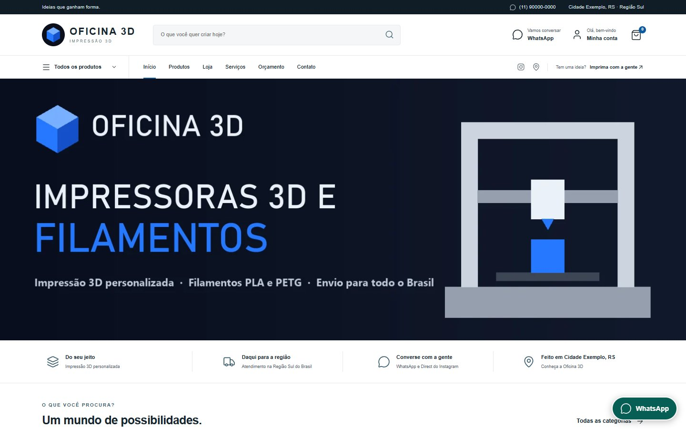

<div align="center">

# 🖨️ Oficina 3D: loja de impressão 3D

**Loja online completa para uma empresa de impressão 3D: catálogo, carrinho, checkout, orçamentos e painel administrativo.**




</div>

## O que é

Uma loja virtual feita sob medida para uma empresa que vende impressoras 3D, filamentos e peças impressas sob encomenda. Além da vitrine, tem pedido de orçamento com anexo de arquivo e um painel para a empresa cuidar de tudo sozinha.

> Projeto desenvolvido sob encomenda. Nome, marca, endereço e contatos do cliente foram substituídos por dados genéricos nesta versão pública.

## Funcionalidades

| Área | O que faz |
|---|---|
| **Catálogo** | Categorias, busca, filtros, ordenação e paginação |
| **Produto** | Galeria, variações, especificações e cálculo de frete |
| **Compra** | Carrinho persistente, reserva de estoque e checkout com Mercado Pago |
| **Cliente** | Cadastro, login e histórico de pedidos (Firebase Authentication) |
| **Orçamentos** | Formulário de impressão sob medida com anexo e proteção contra spam |
| **Painel** | Produtos, estoque, imagens, SEO, pedidos, cupons e anexos |
| **SEO** | Renderização no servidor, canonical, JSON-LD, sitemap dinâmico, robots.txt e llms.txt |
| **Segurança** | Cookies HttpOnly, permissão de admin validada no servidor e limite de tentativas por IP |

## Tecnologias

- **Frontend:** React 19 + TypeScript, empacotado com esbuild
- **Servidor:** Cloudflare Workers com renderização no servidor (SSR)
- **Dados:** Firebase Authentication, Firestore e Storage (via REST)
- **Pagamentos:** Mercado Pago Checkout Pro, com webhook assinado
- **Testes:** suíte própria em Node (segurança, pagamentos, pedidos e SEO) e testes de navegador

## Rodar localmente

```bash
npm ci
npm test          # build + 94 testes
npm run typecheck
npm run dev       # modo demonstração, sem credenciais
```

O modo demonstração roda sem nenhuma conta externa. Para ligar Firebase, Mercado Pago e frete, copie `.env.example` para `.env` e preencha os valores (veja `docs/CONFIGURACAO.md`). Nunca versione o `.env`.

## Licença

Distribuído sob a [Licença Apache 2.0](LICENSE).

Copyright 2026 Ricardo Barnet Ghisio
